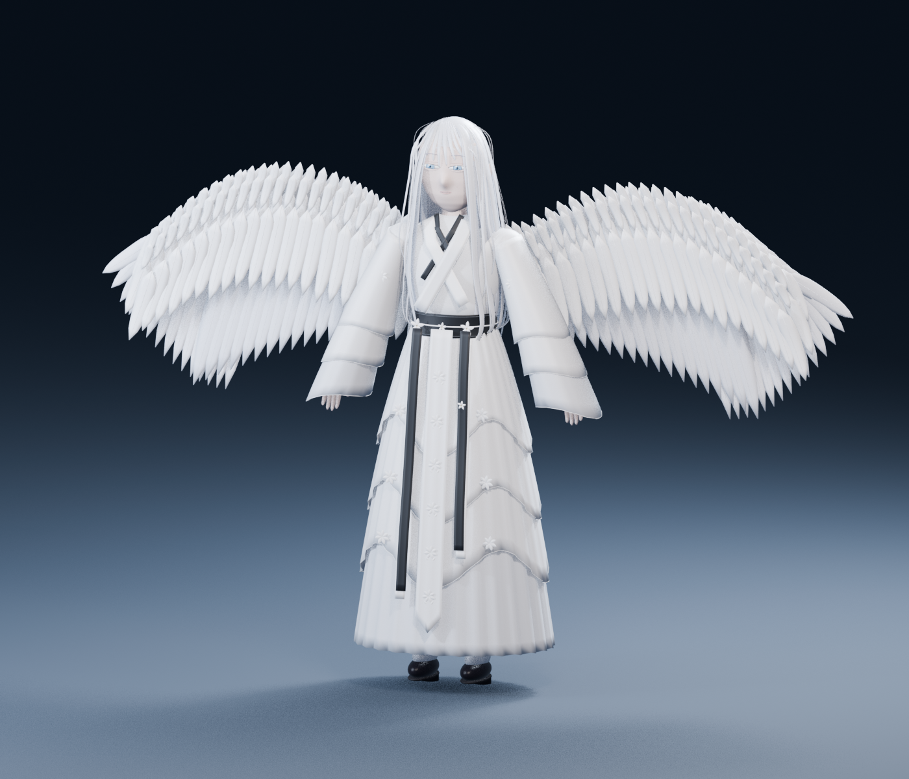

# 源 · Unreal 角色模型初版

基于本对话提供的五张外貌参考制作的可编辑三维角色：银白长发、浅蓝眼睛、白色层叠长衣、黑色腰带与花饰，以及可选白色羽翼。

**当前是需要继续校对相似度的绑定初版，不是完成验收的精雕成品。** 用户提到的文字设定存于 ChatGPT 资料库，尚未提供到本对话，因此本仓库没有假定已读取它。比例与尺寸以图片为依据临时设定，身高约 1.72 米，等待正式设定核对。

## 模型文件

- `output/Yuan_Character.blend`：Blender 4.3 源场景；包含参考图片、分部网格、材质、骨骼、摄影灯光。
- `output/Yuan_Base.fbx`：普通形态，带基础人形与附属骨骼。
- `output/Yuan_Winged.fbx`：带羽翼形态，使用相同骨架。
- `output/Yuan_Winged.glb`：便于通用三维工具预览的版本。
- `output/*LOD1.fbx`、`output/*LOD2.fbx`：自动减面版本，保留面部形态键网格；具体面数见验证报告。
- `output/preview_*.png`：实际模型渲染，不是二维参考图冒充三维成果。
- `output/validation.json`、`output/lod_validation.json` 与 `output/fbx_roundtrip_validation.json`：生成后的网格、面数和权重检查记录。

[Unreal Engine 导入说明](docs/UNREAL_IMPORT.md) · [面部预览](output/preview_portrait.png) · [正面预览](output/preview_front.png) · [羽翼预览](output/preview_winged.png)



## 已实现与实际限制

文件中的材质数值也列于 `output/materials.json`，便于在 Unreal 中核对。

模型具有 90 根骨骼，含手指、头发、衣摆、袖子、腰带和羽翼骨骼；每个顶点最多四个归一化骨骼影响。4 秒待机循环用于检查蒙皮是否能随骨骼运动。普通形态与羽翼形态共用骨架；并非 Epic Manny 的同拓扑或同骨架角色，需要单独配置 IK Retargeter。

面部支持基础双眼闭合形态键；尚无完整口腔、说话视素、ARKit 表情集或面捕绑定。原始网格分件保留，方便修改。材质主要依靠基础色、粗糙度与几何细节，未制作完整高低模烘焙贴图、统一 UV 图集和生产级碰撞体。衣物褶皱、刺绣和羽毛是参照图片做的几何近似，发型与脸部相似度仍需人工继续雕刻校对。

Unreal Engine 未安装于当前环境；已在 Blender 做 FBX 回导检查，**没有声称完成 UE 实机导入验收**。头发、长裙、袖口与羽翼的物理、碰撞、动作重定向、大幅度动作穿插修正仍需在目标项目中设置。自动减面 LOD 需在实际镜头距离下检查细发丝与刺绣。

## 重建

无需额外 Python 库，使用 Blender 自带 Python：

```bash
blender -b --factory-startup -t 8 --python src/build.py
blender -b -t 8 --python src/export_lods.py
blender -b -t 4 --python src/validate_exports.py
```

仅生成模型、不渲染预览：

```bash
blender -b --factory-startup -t 8 --python src/build.py -- --no-render
```

图片位于 `assets/reference/`，只作为用户提供的设计依据。代码按身体、服装、头发、羽翼、骨骼与导出拆分在 `src/`。修改后重新运行生成脚本会覆盖 `output/` 下同名模型；手工继续雕刻时请另存一个 Blender 文件。
